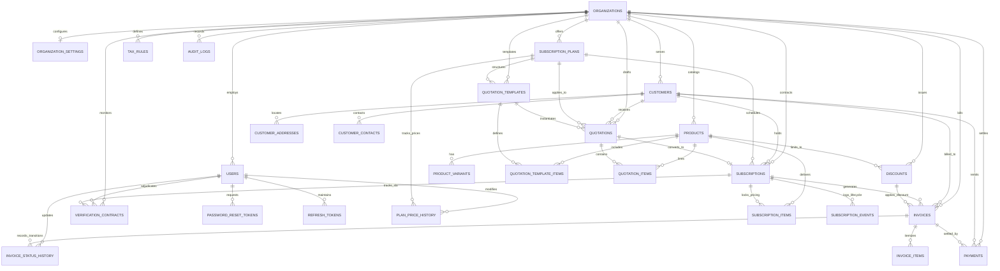

# VERISUB — Database Architecture & Schema Specification (3NF)

---

## 1. Architectural Overview & Design Tenets

VERISUB's database architecture is normalized to **Third Normal Form (3NF)** and engineered to support high-throughput, multi-tenant B2B subscription billing, automated invoice runs, SLA delivery verification, and tamper-evident auditing.

### Key Database Guarantees:
1. **Multi-Tenant Isolation**: Every tenant-owned table enforces `organization_id` with foreign key referencing `organizations.id ON DELETE CASCADE`.
2. **Monetary Precision**: All monetary values are strictly stored as `NUMERIC(12, 2)` (and manipulated as Python `Decimal`). Floating-point arithmetic is banned.
3. **Double-Billing Prevention**: The `invoices` table enforces a database-level `UNIQUE(subscription_id, period_start, period_end)` constraint, guaranteeing that no subscription can ever be billed twice for the same billing window.
4. **Frozen Price Snapshots**: Catalog product price changes never alter historical contracts. Quotations and subscriptions freeze `snapshot_unit_price` at execution time.
5. **Idempotency & Integrity**: Immutable transitions logged in `subscription_events`, `invoice_status_history`, and cryptographically chained `audit_logs` (SHA-256).

---

## 2. Entity-Relationship Diagram (ERD)

---

## 3. Normalized Relational Schema Specifications

### 3.1 Organization & Security

#### `organizations`
- `id` (UUID, PK): Tenant identifier.
- `name` (VARCHAR 255): Organization legal name.
- `slug` (VARCHAR 100, UNIQUE): Clean tenant URL identifier.
- `is_active` (BOOLEAN): Soft-disable switch.
- `created_at`, `updated_at` (TIMESTAMP WITH TIME ZONE).

#### `organization_settings`
- `id` (UUID, PK).
- `organization_id` (UUID, FK `organizations.id` ON DELETE CASCADE, UNIQUE).
- `default_currency` (VARCHAR 10): Default currency ISO code (`USD`, `EUR`, `INR`).
- `timezone` (VARCHAR 50): Default timezone (`UTC`, `America/New_York`).
- `dunning_max_retries` (INTEGER): Dunning retry count for failed payments.
- `dunning_retry_interval_days` (INTEGER): Interval days between payment retries.

#### `users`
- `id` (UUID, PK).
- `organization_id` (UUID, FK `organizations.id` ON DELETE CASCADE).
- `customer_id` (UUID, FK `customers.id` ON DELETE SET NULL, NULLABLE): Set when role is `CUSTOMER`.
- `email` (VARCHAR 255, UNIQUE): Primary user work email.
- `password_hash` (VARCHAR 255): Cryptographic Argon2id password hash.
- `full_name` (VARCHAR 255): User display name.
- `role` (VARCHAR 50): RBAC role (`ADMIN`, `STAFF`, `CUSTOMER`).
- `is_active` (BOOLEAN): User active flag.
- `is_verified` (BOOLEAN): Email verification status.
- `created_at`, `updated_at` (TIMESTAMP WITH TIME ZONE).

#### `password_reset_tokens`
- `id` (UUID, PK).
- `user_id` (UUID, FK `users.id` ON DELETE CASCADE).
- `token_hash` (VARCHAR 255, UNIQUE): Cryptographic hash of password recovery token.
- `expires_at` (TIMESTAMP WITH TIME ZONE): Token expiration window.
- `used_at` (TIMESTAMP WITH TIME ZONE, NULLABLE): Consumption timestamp.

#### `refresh_tokens`
- `id` (UUID, PK).
- `user_id` (UUID, FK `users.id` ON DELETE CASCADE).
- `token_hash` (VARCHAR 255, UNIQUE): Secure hash of rotating JWT refresh token.
- `expires_at` (TIMESTAMP WITH TIME ZONE).
- `revoked_at` (TIMESTAMP WITH TIME ZONE, NULLABLE).

---

### 3.2 Customer Relationship

#### `customers`
- `id` (UUID, PK).
- `organization_id` (UUID, FK `organizations.id` ON DELETE CASCADE).
- `customer_code` (VARCHAR 50): Unique account identifier per organization.
- `company_name` (VARCHAR 255): B2B entity name.
- `contact_name` (VARCHAR 255): Primary contact person.
- `email` (VARCHAR 255): Primary billing contact email.
- `phone` (VARCHAR 50): Phone contact.
- `tax_identifier` (VARCHAR 100): GSTIN, VAT, or EIN tax identification number.
- `billing_address` (VARCHAR 500): Default billing address.
- `shipping_address` (VARCHAR 500): Service deployment address.
- `status` (VARCHAR 30): `ACTIVE`, `INACTIVE`, `SUSPENDED`.
- **Constraints**:
  - `UNIQUE(organization_id, customer_code)`
  - `UNIQUE(organization_id, email)`

#### `customer_addresses`
- `id` (UUID, PK).
- `customer_id` (UUID, FK `customers.id` ON DELETE CASCADE).
- `address_type` (VARCHAR 20): `BILLING`, `SHIPPING`, `SERVICE`.
- `street`, `city`, `state`, `postal_code`, `country`.

#### `customer_contacts`
- `id` (UUID, PK).
- `customer_id` (UUID, FK `customers.id` ON DELETE CASCADE).
- `name`, `email`, `phone`, `designation`.

---

### 3.3 Catalog: Products, Variants & Subscription Plans

#### `products`
- `id` (UUID, PK).
- `organization_id` (UUID, FK `organizations.id` ON DELETE CASCADE).
- `name` (VARCHAR 255): Product name.
- `product_type` (VARCHAR 50): `SAAS`, `SERVICE`, `GOODS`, `LICENSE`.
- `description` (TEXT).
- `sales_price` (NUMERIC 12, 2): Base retail price (`CHECK(sales_price >= 0)`).
- `cost_price` (NUMERIC 12, 2): Wholesale/internal cost (`CHECK(cost_price >= 0)`).
- `notes` (TEXT).
- `status` (VARCHAR 30): `ACTIVE`, `INACTIVE`, `ARCHIVED`.
- **Constraints**: `UNIQUE(organization_id, name)`.

#### `product_variants`
- `id` (UUID, PK).
- `product_id` (UUID, FK `products.id` ON DELETE CASCADE).
- `variant_name` (VARCHAR 255): e.g. "Brand Odoo", "High Availability Tier".
- `description` (TEXT).
- `additional_price` (NUMERIC 12, 2): Incremental price added to base product (`CHECK(additional_price >= 0)`).
- `status` (VARCHAR 30): `ACTIVE`, `INACTIVE`.
- **Constraints**: `UNIQUE(product_id, variant_name)`.

#### `subscription_plans`
- `id` (UUID, PK).
- `organization_id` (UUID, FK `organizations.id` ON DELETE CASCADE).
- `name` (VARCHAR 255): Plan title.
- `description` (TEXT).
- `billing_frequency` (VARCHAR 20): `DAILY`, `WEEKLY`, `MONTHLY`, `YEARLY`.
- `plan_price` (NUMERIC 12, 2): Contract cadence price (`CHECK(plan_price >= 0)`).
- `minimum_quantity` (INTEGER): Min committed units (`CHECK(minimum_quantity >= 1)`).
- `start_availability_date` (DATE).
- `end_availability_date` (DATE, NULLABLE).
- **First-Class Flags**:
  - `is_auto_close_at_end` (BOOLEAN): Auto-terminate subscription on expiration.
  - `is_closable_early` (BOOLEAN): Permits early customer/admin cancellation.
  - `is_pausable` (BOOLEAN): Permits temporary subscription pausing.
  - `is_renewable` (BOOLEAN): Permits recurring period extensions.
- `auto_close_configuration`, `early_closure_configuration`, `pause_configuration`, `renewal_configuration` (JSON).
- `status` (VARCHAR 30): `ACTIVE`, `INACTIVE`, `ARCHIVED`.
- **Constraints**:
  - `UNIQUE(organization_id, name)`
  - `CHECK(end_availability_date IS NULL OR start_availability_date IS NULL OR end_availability_date >= start_availability_date)`

#### `plan_price_history`
- `id` (UUID, PK).
- `plan_id` (UUID, FK `subscription_plans.id` ON DELETE CASCADE).
- `price` (NUMERIC 12, 2): Historical price point.
- `effective_from` (TIMESTAMP WITH TIME ZONE).
- `notes` (VARCHAR 255): Audit justification.

---

### 3.4 Taxes & Discounts

#### `tax_rules`
- `id` (UUID, PK).
- `organization_id` (UUID, FK `organizations.id` ON DELETE CASCADE).
- `name` (VARCHAR 100): Rule label (e.g. `GST 18%`, `State Sales Tax 8.25%`).
- `tax_type` (VARCHAR 50): `VAT`, `GST`, `SALES_TAX`.
- `rate_percentage` (NUMERIC 5, 2): Percentage rate (`CHECK(rate_percentage >= 0 AND rate_percentage <= 100)`).
- `country_code` (VARCHAR 10).
- `state_or_province` (VARCHAR 100, NULLABLE).
- `is_active` (BOOLEAN).
- **Constraints**: `UNIQUE(organization_id, name)`.

#### `discounts`
- `id` (UUID, PK).
- `organization_id` (UUID, FK `organizations.id` ON DELETE CASCADE).
- `code` (VARCHAR 50): Coupon code (e.g. `ENTERPRISE20`).
- `name` (VARCHAR 255): Promotional campaign name.
- `discount_type` (VARCHAR 20): `PERCENTAGE` or `FIXED_AMOUNT`.
- `discount_value` (NUMERIC 12, 2): Amount or percentage (`CHECK(discount_value >= 0)`).
- `min_purchase_amount` (NUMERIC 12, 2): Minimum invoice threshold (`CHECK(min_purchase_amount >= 0)`).
- `min_quantity` (INTEGER): Minimum units (`CHECK(min_quantity >= 1)`).
- `start_date` (DATE).
- `end_date` (DATE, NULLABLE).
- `max_uses` (INTEGER, NULLABLE): Maximum allowed redemptions.
- `times_used` (INTEGER): Atomic usage counter (`CHECK(times_used >= 0)`).
- `product_id` (UUID, FK `products.id` ON DELETE SET NULL, NULLABLE): Specific product restriction.
- `applies_to_subscription` (BOOLEAN): Auto-apply to recurring billing runs.
- `is_active` (BOOLEAN).
- **Constraints**:
  - `UNIQUE(organization_id, code)`
  - `CHECK(end_date IS NULL OR end_date >= start_date)`

---

### 3.5 Quotations & Subscriptions

#### `quotation_templates`
- `id` (UUID, PK).
- `organization_id` (UUID, FK `organizations.id` ON DELETE CASCADE).
- `name` (VARCHAR 255): Template name (e.g. `Standard SaaS Starter`).
- `plan_id` (UUID, FK `subscription_plans.id` ON DELETE RESTRICT).
- `default_valid_days` (INTEGER): Default quotation validity period (`CHECK(default_valid_days > 0)`).
- `notes` (TEXT).
- `is_active` (BOOLEAN).
- **Constraints**: `UNIQUE(organization_id, name)`.

#### `quotation_template_items`
- `id` (UUID, PK).
- `template_id` (UUID, FK `quotation_templates.id` ON DELETE CASCADE).
- `product_id` (UUID, FK `products.id` ON DELETE RESTRICT).
- `variant_id` (UUID, FK `product_variants.id` ON DELETE SET NULL, NULLABLE).
- `quantity` (INTEGER): Default units (`CHECK(quantity > 0)`).

#### `quotations`
- `id` (UUID, PK).
- `organization_id` (UUID, FK `organizations.id` ON DELETE CASCADE).
- `customer_id` (UUID, FK `customers.id` ON DELETE RESTRICT).
- `template_id` (UUID, FK `quotation_templates.id` ON DELETE SET NULL, NULLABLE).
- `quotation_number` (VARCHAR 50).
- `quotation_date` (DATE).
- `expiry_date` (DATE).
- `subtotal` (NUMERIC 12, 2): `CHECK(subtotal >= 0)`.
- `discount_total` (NUMERIC 12, 2): `CHECK(discount_total >= 0)`.
- `tax_total` (NUMERIC 12, 2): `CHECK(tax_total >= 0)`.
- `grand_total` (NUMERIC 12, 2): `CHECK(grand_total >= 0)`.
- `status` (VARCHAR 30): `DRAFT`, `SENT`, `CONFIRMED`, `CANCELLED`, `CONVERTED`.
- `notes` (TEXT).
- **Constraints**: `UNIQUE(organization_id, quotation_number)`.

#### `quotation_items`
- `id` (UUID, PK).
- `quotation_id` (UUID, FK `quotations.id` ON DELETE CASCADE).
- `product_id` (UUID, FK `products.id` ON DELETE RESTRICT).
- `variant_id` (UUID, FK `product_variants.id` ON DELETE RESTRICT, NULLABLE).
- `plan_id` (UUID, FK `subscription_plans.id` ON DELETE SET NULL, NULLABLE).
- `description` (VARCHAR 255): Snapshot description.
- `quantity` (INTEGER): `CHECK(quantity > 0)`.
- `unit_price` (NUMERIC 12, 2): Frozen snapshot unit price (`CHECK(unit_price >= 0)`).
- `tax_configuration_reference` (VARCHAR 100).
- `line_total` (NUMERIC 12, 2): `CHECK(line_total >= 0)`.

#### `subscriptions`
- `id` (UUID, PK).
- `organization_id` (UUID, FK `organizations.id` ON DELETE CASCADE).
- `customer_id` (UUID, FK `customers.id` ON DELETE RESTRICT).
- `plan_id` (UUID, FK `subscription_plans.id` ON DELETE RESTRICT).
- `quotation_id` (UUID, FK `quotations.id` ON DELETE SET NULL, NULLABLE).
- `subscription_number` (VARCHAR 50).
- `start_date` (DATE).
- `next_billing_date` (DATE).
- `expiry_date` (DATE, NULLABLE).
- `billing_frequency` (VARCHAR 20): `DAILY`, `WEEKLY`, `MONTHLY`, `YEARLY`.
- `payment_terms` (VARCHAR 50): e.g. `NET_30`.
- `status` (VARCHAR 30): `DRAFT`, `QUOTATION`, `CONFIRMED`, `ACTIVE`, `PAUSED`, `CLOSED`.
- `currency` (VARCHAR 10): Default currency code.
- `renewal_enabled` (BOOLEAN).
- `pause_information` (JSON): Pause reason, paused timestamp, scheduled resume date.
- `closure_information` (JSON): Close reason, early termination fee.
- `recurring_amount` (NUMERIC 12, 2): `CHECK(recurring_amount >= 0)`.
- **Constraints**:
  - `UNIQUE(organization_id, subscription_number)`
  - `CHECK(expiry_date IS NULL OR expiry_date >= start_date)`

#### `subscription_items`
- `id` (UUID, PK).
- `subscription_id` (UUID, FK `subscriptions.id` ON DELETE CASCADE).
- `product_id` (UUID, FK `products.id` ON DELETE RESTRICT).
- `variant_id` (UUID, FK `product_variants.id` ON DELETE SET NULL, NULLABLE).
- `description_snapshot` (VARCHAR 255).
- `quantity` (INTEGER): `CHECK(quantity > 0)`.
- `unit_price_snapshot` (NUMERIC 12, 2): `CHECK(unit_price_snapshot >= 0)`.
- `line_total` (NUMERIC 12, 2): `CHECK(line_total >= 0)`.

#### `subscription_events`
- `id` (UUID, PK).
- `subscription_id` (UUID, FK `subscriptions.id` ON DELETE CASCADE).
- `event_type` (VARCHAR 50): `CREATED`, `ACTIVATED`, `PAUSED`, `RESUMED`, `RENEWED`, `CLOSED`.
- `previous_status`, `new_status` (VARCHAR 30).
- `description` (TEXT).
- `metadata_json` (JSON).
- `created_at` (TIMESTAMP WITH TIME ZONE).

---

### 3.6 Invoices & Settlement

#### `invoices`
- `id` (UUID, PK).
- `organization_id` (UUID, FK `organizations.id` ON DELETE CASCADE).
- `customer_id` (UUID, FK `customers.id` ON DELETE CASCADE).
- `subscription_id` (UUID, FK `subscriptions.id` ON DELETE SET NULL, NULLABLE).
- `invoice_number` (VARCHAR 50).
- `issue_date` (DATE).
- `due_date` (DATE).
- `period_start` (DATE, NULLABLE).
- `period_end` (DATE, NULLABLE).
- `subtotal` (NUMERIC 12, 2): `CHECK(subtotal >= 0)`.
- `discount_total` (NUMERIC 12, 2): `CHECK(discount_total >= 0)`.
- `sla_credit_amount` (NUMERIC 12, 2): Service credits (`CHECK(sla_credit_amount >= 0)`).
- `tax_total` (NUMERIC 12, 2): `CHECK(tax_total >= 0)`.
- `total_amount` (NUMERIC 12, 2): `CHECK(total_amount >= 0)`.
- `amount_paid` (NUMERIC 12, 2): Cumulative paid (`CHECK(amount_paid >= 0)`).
- `amount_due` (NUMERIC 12, 2): Outstanding balance (`CHECK(amount_due >= 0)`).
- `status` (VARCHAR 30): `DRAFT`, `ISSUED`, `CONFIRMED`, `PARTIALLY_PAID`, `PAID`, `OVERDUE`, `CANCELLED`.
- `verification_status` (VARCHAR 30): `VERIFIED`, `PENDING`, `FLAGGED`.
- **Double Billing Prevention**:
  - `UNIQUE(subscription_id, period_start, period_end)`
- **Constraints**:
  - `UNIQUE(organization_id, invoice_number)`
  - `CHECK(due_date >= issue_date)`
  - `CHECK(period_end IS NULL OR period_start IS NULL OR period_end >= period_start)`

#### `invoice_items`
- `id` (UUID, PK).
- `invoice_id` (UUID, FK `invoices.id` ON DELETE CASCADE).
- `description` (VARCHAR 255).
- `quantity` (INTEGER): `CHECK(quantity > 0)`.
- `unit_price` (NUMERIC 12, 2): `CHECK(unit_price >= 0)`.
- `line_total` (NUMERIC 12, 2): `CHECK(line_total >= 0)`.

#### `invoice_status_history`
- `id` (UUID, PK).
- `invoice_id` (UUID, FK `invoices.id` ON DELETE CASCADE).
- `from_status`, `to_status` (VARCHAR 50).
- `changed_by_user_id` (UUID, FK `users.id` ON DELETE SET NULL, NULLABLE).
- `reason` (VARCHAR 255).
- `created_at` (TIMESTAMP WITH TIME ZONE).

#### `payments`
- `id` (UUID, PK).
- `organization_id` (UUID, FK `organizations.id` ON DELETE CASCADE).
- `invoice_id` (UUID, FK `invoices.id` ON DELETE CASCADE).
- `amount` (NUMERIC 12, 2): Payment amount (`CHECK(amount > 0)`).
- `payment_method` (VARCHAR 50): `BANK_TRANSFER`, `ACH`, `CREDIT_CARD`, `SIMULATED_GATEWAY`.
- `payment_date` (TIMESTAMP WITH TIME ZONE).
- `transaction_reference` (VARCHAR 100, NULLABLE).
- `status` (VARCHAR 30): `COMPLETED`, `PENDING`, `FAILED`, `REFUNDED`.
- `notes` (TEXT).

---

### 3.7 SLA Verification & Tamper-Evident Audit

#### `verification_contracts`
- `id` (UUID, PK).
- `organization_id` (UUID, FK `organizations.id` ON DELETE CASCADE).
- `contract_number` (VARCHAR 50).
- `subscription_id` (UUID, FK `subscriptions.id` ON DELETE CASCADE).
- `service_name` (VARCHAR 255).
- `sla_commitment_description` (VARCHAR 255): e.g. "99.99% monthly uptime".
- `target_uptime_percentage` (NUMERIC 5, 2): `CHECK(target_uptime_percentage >= 0 AND target_uptime_percentage <= 100)`.
- `actual_recorded_telemetry` (VARCHAR 255): e.g. "741.2 operating hours, 168 mins downtime".
- `breach_detected` (BOOLEAN): Breach flag.
- `proposed_credit_amount` (NUMERIC 12, 2): Adjudicated credit (`CHECK(proposed_credit_amount >= 0)`).
- `status` (VARCHAR 30): `PENDING_REVIEW`, `VERIFIED_COMPLIANT`, `CREDIT_APPROVED`, `CREDIT_REJECTED`.
- `adjudicated_at` (TIMESTAMP WITH TIME ZONE, NULLABLE).
- `adjudicated_by` (UUID, FK `users.id` ON DELETE SET NULL, NULLABLE).
- **Constraints**: `UNIQUE(organization_id, contract_number)`.

#### `audit_logs` (Cryptographic Hash-Chain)
- `id` (UUID, PK).
- `organization_id` (UUID, FK `organizations.id` ON DELETE CASCADE).
- `sequence_number` (INTEGER): Strictly sequential block index.
- `previous_hash` (VARCHAR 64): SHA-256 hash of preceding entry.
- `current_hash` (VARCHAR 64): SHA-256 of `sequence_number + previous_hash + payload_json + created_at`.
- `entity_type` (VARCHAR 50): `SUBSCRIPTION`, `INVOICE`, `PAYMENT`, `DISCOUNT`.
- `entity_id` (VARCHAR 100).
- `action` (VARCHAR 50): `CREATED`, `UPDATED`, `STATUS_CHANGED`, `CREDIT_APPLIED`.
- `actor_email` (VARCHAR 255).
- `payload_json` (TEXT): Complete state diff.
- `created_at` (TIMESTAMP WITH TIME ZONE).
- **Constraints**: `UNIQUE(organization_id, sequence_number)`.

---

## 4. Comprehensive Index Inventory & Performance Justifications

| Table | Index Name | Indexed Columns | One-Line Performance Justification |
| :--- | :--- | :--- | :--- |
| `users` | `ix_users_org_role` | `(organization_id, role)` | Accelerates user filtering by role (e.g. finding staff/admins) within tenant boundaries. |
| `customers` | `ix_customers_org_status` | `(organization_id, status)` | Powers customer directory filtering by status (Active/Inactive) under 20ms. |
| `products` | `ix_products_org_status` | `(organization_id, status)` | Fast retrieval of active product catalog for quotation drafting. |
| `subscription_plans` | `ix_plans_org_status` | `(organization_id, status)` | Immediate listing of active plans for subscription checkout. |
| `subscriptions` | `ix_subscriptions_org_status` | `(organization_id, status)` | Powers the finance dashboard active subscription counters with instant indexed count. |
| `subscriptions` | `ix_subscriptions_billing_due` | `(organization_id, next_billing_date, status)` | Sub-second extraction of subscriptions due for automated invoice generation batches. |
| `invoices` | `uq_invoice_subscription_period` | `(subscription_id, period_start, period_end)` | **Double-billing prevention**: unique index guaranteeing zero duplicate invoices per period. |
| `invoices` | `ix_invoices_org_status_due` | `(organization_id, status, due_date)` | Instant identification of overdue invoices (`status != 'PAID' AND due_date < today`). |
| `payments` | `ix_payments_invoice_status` | `(invoice_id, status)` | Instant calculation of cumulative completed payments against an open invoice. |
| `discounts` | `ix_discounts_org_code_active` | `(organization_id, code, is_active)` | Sub-millisecond coupon code validation during quotation and billing calculations. |
| `tax_rules` | `ix_tax_rules_org_active` | `(organization_id, is_active)` | Fast loading of applicable tax rates for order calculations. |
| `verification_contracts` | `ix_verification_org_breach_status` | `(organization_id, breach_detected, status)` | Drives the AI Insights radar to instantly surface pending SLA breach adjudications. |
| `audit_logs` | `ix_audit_org_entity` | `(organization_id, entity_type, entity_id)` | Fast historical audit trail retrieval for any individual customer or subscription. |
| `audit_logs` | `uq_org_audit_seq` | `(organization_id, sequence_number)` | Guaranteed sequential hash-chain traversal for cryptographic verification audits. |
